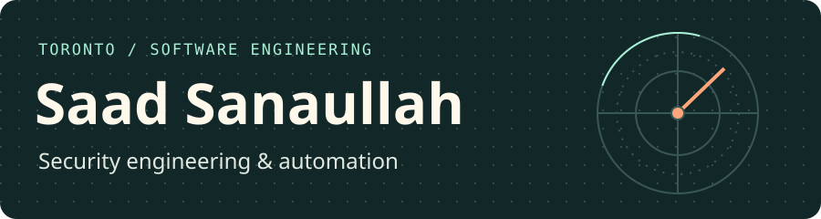

| 🎯 Security operations | 📊 Data engineering | 🎮 Game development |
| --- | --- | --- |
| CompTIA Security+ certified. My team placed **2nd of 15** in RBC’s Splunk Boss of the SOC competition. | I co-designed a [Clover ETL pipeline](https://github.com/bluwale/clover-financial-insights-pipeline) for two stores. It syncs changed records nightly and flags invalid rows for review. | I built interfaces and enemy patrols in Godot at Dough Dough Digital. My [Python TicTacToe “AI”](https://github.com/bluwale/TicTacToe) had a simpler job: block your win and look for its own. |

### Tech stack

**Security**  
    

**Languages & development tools**  
          

**Infrastructure**  
   

**Certifications** · CompTIA Security+ · Microsoft Azure Fundamentals (AZ-900) · CyberStart Canada

### Connect

I'm looking for a **Summer 2027 security engineering or automation internship** in Toronto.

[LinkedIn ↗](https://www.linkedin.com/in/saad-sanaullah-2630101b5/) · [Email me ↗](mailto:saad.sanaullah04@gmail.com)

**Off the clock**　⚽ Soccer　·　🎬 Movies　·　🏎️ Cars
